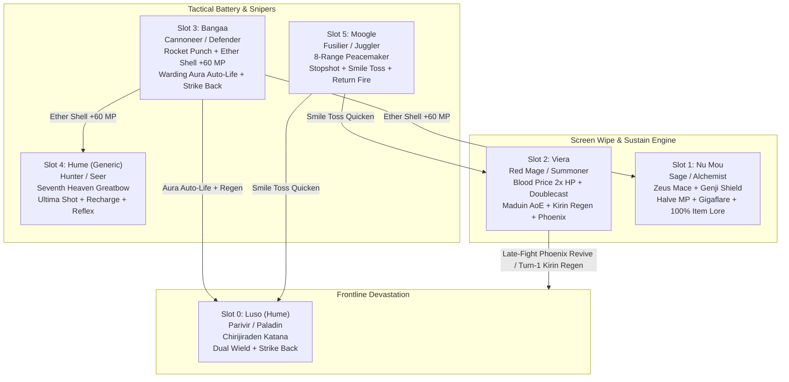

# FFTA2 Clan Meta Squad Architecture & Strategy (v4 Audited & Legal)

Fully audited and legally verified tactical specification for *Final Fantasy Tactics A2: Grimoire of the Rift*, resolving all equipment proficiencies, job ability origins, HP-cost mechanics, and exact ROM hex IDs.

---

## 1. Corrections from Chief Audit (`ffta2_meta_squad_strategy_review.md`)

1. **Exact ROM Hex ID Corrections**:
   - *Shimmering Blade*: `0x63` (was incorrectly listed as `0x66`, which is Lifethread Blade).
   - *Bio*: `0xF1` (was `0xEF`, which is Esunaga).
   - *Kirin*: `0x146` (was `0x143`, which is Ifrit).
   - *Mortar*: `0xCD` (was `0xCE`, which is Target).
   - *Target*: `0xCE`.
   - *"Items" Ability Set*: `0x56` (distinct from `0x1A` Alchemy).

2. **Race & Job Legality Corrections**:
   - **Luso / Hume Support**: *Unscarred* (`0x365`) is Master Monk (Bangaa) and Ravager (Gria) exclusive; Humes cannot learn it. Luso legally adopts **Dual Wield** (`0x35C`, Ninja Support). Equipping two high-tier katanas doubles standard attack and Flair blade burst damage.
   - **Moogle Reaction**: *Reflex* (`0x33A`) cannot be learned by any Moogle class. Moogle legally equips **Return Fire** (`0x33E`, Fusilier Reaction; catches and deflects ranged projectiles) or **Critical: Quicken** (`0x336`, Time Mage).
   - **Aura Origin**: *Aura* (`0xAC`, Auto-Life / Reraise + Regen) is learned through **Warding** (`0x11`, Defender), not Templar. Bangaa Cannoneer sets secondary ability set to Warding (`0x11`).
   - **Blood Price Mechanics**: *Blood Price* (`0x36A`) costs **2x the spell's MP cost in HP**. Doublecast Maduin (32 MP) costs 64 HP per cast (128 HP total). Viera equips **Angel Ring** (`0x0189`, Auto-Reraise) as a safety net against self-KO, and opens Turn 1 with single Maduin (64 HP) + Kirin (36 HP Regen) or Unicorn (24 HP Cleanse).

3. **Equipment Proficiency Legality**:
   - **Slot 0 (Parivir)**: Proficient only with Katanas, Hats, Light Armor (NO Shields, NO Helms, NO Heavy Armor). Main: *Chirijiraden* (`0x0018`), Off: *Hyakushiki-masamune* (`0x0074`, +78 Atk Katana, Dual Wield), Head: *Thief's Cap* (`0x013F`, +2 Speed), Body: *Ninja Gear* (`0x015C`, +24 Def, +4 Speed), Acc: *Ninja Tabi* (`0x0180`, +2 Move).
   - **Slot 1 (Sage)**: Proficient with Maces, Shields, Robes (NOT Rods). Weapon: *Zeus Mace* (`0x010F`), Shield: *Genji Shield* (`0x0127`), Head: *Gold Hairpin* (`0x013E`), Body: *Lordly Robe* (`0x0171`), Acc: *Faerie Shoes* (`0x017E`, Teleport Movement).
   - **Slot 2 (Red Mage)**: Weapon: *Femme Fatale* (`0x0050`), Head: *Ribbon* (`0x0138`), Body: *Minerva Bustier* (`0x015B`), Acc: *Angel Ring* (`0x0189`).
   - **Slot 3 (Cannoneer)**: Proficient with Hand Cannons, Hats, Light Armor (NO Heavy Helms, NO Heavy Armor). Weapon: *Rocket Punch* (`0x00F0`), Head: *Thief's Cap* (`0x013F`), Body: *Mirage Vest* (`0x015F`), Acc: *Genji Gloves* (`0x0184`).
   - **Slot 4 (Hunter)**: Weapon: *Seventh Heaven* (`0x00CA`), Head: *Thief's Cap* (`0x013F`), Body: *Ninja Gear* (`0x015C`), Acc: *Winged Boots* (`0x017B`).
   - **Slot 5 (Fusilier)**: Weapon: *Peacemaker* (`0x00D4`), Head: *Thief's Cap* (`0x013F`), Body: *Mirage Vest* (`0x015F`), Acc: *Ninja Tabi* (`0x0180`).

---

## 2. Squad Tactical Architecture

---

## 3. Verified Squad Builds & ROM Hex Reference

### Slot 0: Luso (Hume), The Dual Katana Blademaster

- **Primary Job**: **Parivir** (`0x08`)
- **Secondary Ability Set**: **Chivalry** (Paladin, `0x06`)
- **Reaction**: **Strike Back** (`0x33C`, Fighter): neutralizes incoming melee physical attacks and counters.
- **Support**: **Dual Wield** (`0x35C`, Ninja): equips two weapons; standard attacks and Flair blades deliver twin strikes.
- **Key Abilities**:
  - *Skyfury Blade* (`0x64`), *Hoarfrost Blade* (`0x65`), *Shimmering Blade* (`0x63`)
  - *Nurse* (`0x50`: cleanses ailments + heals area), *Saint Cross* (`0x54`), *Holy Blade* (`0x55`)
- **Equipment (100% Legal Proficiencies)**:
  - Main Hand: **Chirijiraden** (`0x0018`, +65 Atk, Fire Katana)
  - Off Hand: **Hyakushiki-masamune** (`0x0074`, +78 Atk Katana, Dual Wield)
  - Head: **Thief's Cap** (`0x013F`, +2 Speed Hat)
  - Body: **Ninja Gear** (`0x015C`, +24 Def, +4 Speed Light Armor)
  - Accessory: **Ninja Tabi** (`0x0180`, +2 Move)

---

### Slot 1: Nu Mou, The Arcane Mace Medic

- **Primary Job**: **Sage** (`0x1F`)
- **Secondary Ability Set**: **Alchemy** (Alchemist, `0x1A`)
- **Reaction**: **Reflex** (`0x33A`, Sage): dodges all standard physical strikes.
- **Support**: **Halve MP** (`0x35E`, Bishop): cuts Gigaflare to 16 MP and Bio to 12 MP.
- **Key Abilities**:
  - *Gigaflare* (`0xF0`), *Bio* (`0xF1`), *Aero* (`0x47`)
  - *Items* (Alchemy unlocks infinite-range 100% success-rate delivery of Remedies, X-Potions, Phoenix Downs)
- **Equipment (100% Legal Proficiencies)**:
  - Main Hand: **Zeus Mace** (`0x010F`, +30 Atk, +5 Def, +10 Magick)
  - Off Hand: **Genji Shield** (`0x0127`, +7 Def, +5 Evade, +2 MRes)
  - Head: **Gold Hairpin** (`0x013E`, +10 MRes)
  - Body: **Lordly Robe** (`0x0171`, +18 Def, +35 MRes)
  - Accessory: **Faerie Shoes** (`0x017E`, Teleport Movement)

---

### Slot 2: Viera, The Blood Price Doublecaster

- **Primary Job**: **Red Mage** (`0x27`)
- **Secondary Ability Set**: **Summoning Magick** (Summoner, `0x24`)
- **Reaction**: **Reflex** (`0x33A`, Fencer)
- **Support**: **Blood Price** (`0x36A`, Spellblade): spells consume HP at 2x the normal MP cost.
- **Key Abilities**:
  - *Double Cast* (`0x139`): Casts two spells per turn.
  - *Maduin* (`0x148`): Non-elemental area damage (32 MP = 64 HP).
  - *Kirin* (`0x146`): AoE party Regen (18 MP = 36 HP).
  - *Unicorn* (`0x142`): AoE status ailment cleanse (12 MP = 24 HP).
  - *Phoenix* (`0x149`): Full AoE party revive + heal (24 MP = 48 HP).
  - *Cure* (`0x37`): Restores HP to self/ally (6 MP = 12 HP).
- **Equipment (100% Legal Proficiencies)**:
  - Weapon: **Femme Fatale** (`0x0050`, +49 Atk, +2 Mag Rapier)
  - Head: **Ribbon** (`0x0138`, Complete status ailment immunity)
  - Body: **Minerva Bustier** (`0x015B`, Dark/Holy absorption)
  - Accessory: **Angel Ring** (`0x0189`, Auto-Reraise safety against Blood Price self-KO)

---

### Slot 3: Bangaa, The Artillery Battery & Defender

- **Primary Job**: **Cannoneer** (`0x16`)
- **Secondary Ability Set**: **Warding** (Defender, `0x11`)
- **Reaction**: **Strike Back** (`0x33C`, White Monk)
- **Support**: **Attack Up** (`0x353`, Warrior)
- **Key Abilities**:
  - *Ether Shell* (`0xD0`): Restores +60 MP to any ally across the battlefield.
  - *Mortar* (`0xCD`): Long-range artillery shell.
  - *Target* (`0xCE`): Boosts accuracy for next turn.
  - *Aura* (`0xAC`): Bestows Auto-Life (Reraise) + Regen on critical allies.
  - *Meltdown* (`0xAE`), *Mow Down* (`0xAB`).
- **Equipment (100% Legal Proficiencies)**:
  - Weapon: **Rocket Punch** (`0x00F0`, Hand Cannon)
  - Head: **Thief's Cap** (`0x013F`, +2 Speed Hat)
  - Body: **Mirage Vest** (`0x015F`, +30 Def, +12 MRes Light Armor)
  - Accessory: **Genji Gloves** (`0x0184`, +5 Attack, +5 Defense)

---

### Slot 4: Hume (Generic), The Long-Range Sniper & High Magick Battery

- **Primary Job**: **Hunter** (`0x0C`)
- **Secondary Ability Set**: **High Magick** (Seer, `0x0D`)
- **Reaction**: **Reflex** (`0x33A`, Paladin)
- **Support**: **Concentration** (`0x361`, Archer)
- **Key Abilities**:
  - *Ultima Shot* (`0x92`): 6-tile Greatbow range single-target execution.
  - *Recharge* (`0x94`): Secondary MP battery restoration.
  - *Magick Frenzy* (`0x95`): Follows magick casts with immediate physical Greatbow strikes.
  - *Esuna* (`0x3A`): Status cleanse.
- **Equipment (100% Legal Proficiencies)**:
  - Weapon: **Seventh Heaven** (`0x00CA`, Greatbow)
  - Head: **Thief's Cap** (`0x013F`, +2 Speed Hat)
  - Body: **Ninja Gear** (`0x015C`, +24 Def, +4 Speed Light Armor)
  - Accessory: **Winged Boots** (`0x017B`, Float / Levitate)

---

### Slot 5: Moogle, The Lock-Down & Turn Engine

- **Primary Job**: **Fusilier** (`0x30`)
- **Secondary Ability Set**: **Acrobatics** (Juggler, `0x2A`)
- **Reaction**: **Return Fire** (`0x33E`, Fusilier): intercepts and returns ranged attacks.
- **Support**: **Concentration** (`0x361`, Fusilier): maximizes status bullet hit rates.
- **Key Abilities**:
  - *Stopshot* (`0x170`): 8-tile Stop status lock.
  - *Charmshot* (`0x16D`): 8-tile Charm control.
  - *Smile Toss* (`0x176`): Grants immediate turn (Quicken) to Luso or Viera.
- **Equipment (100% Legal Proficiencies)**:
  - Weapon: **Peacemaker** (`0x00D4`, 8-Range Gun)
  - Head: **Thief's Cap** (`0x013F`, +2 Speed Hat)
  - Body: **Mirage Vest** (`0x015F`, +30 Def, +12 MRes Light Armor)
  - Accessory: **Ninja Tabi** (`0x0180`, +2 Move)

---

## 4. Master Verified ROM Hex Reference Table

| Slot | Unit / Race | Primary Job | Secondary Set | Reaction | Support | Weapon | Weapon ID |
|---|---|---|---|---|---|---|---|
| **0** | Luso (Hume) | Parivir (`0x08`) | Chivalry (`0x06`) | Strike Back (`0x33C`) | Dual Wield (`0x35C`) | Chirijiraden | `0x0018` |
| **1** | Nu Mou | Sage (`0x1F`) | Alchemy (`0x1A`) | Reflex (`0x33A`) | Halve MP (`0x35E`) | Zeus Mace | `0x010F` |
| **2** | Viera | Red Mage (`0x27`) | Summoning (`0x24`) | Reflex (`0x33A`) | Blood Price (`0x36A`) | Femme Fatale | `0x0050` |
| **3** | Bangaa | Cannoneer (`0x16`) | Warding (`0x11`) | Strike Back (`0x33C`) | Attack Up (`0x353`) | Rocket Punch | `0x00F0` |
| **4** | Hume (Generic) | Hunter (`0x0C`) | High Magick (`0x0D`) | Reflex (`0x33A`) | Concentration (`0x361`) | Seventh Heaven | `0x00CA` |
| **5** | Moogle | Fusilier (`0x30`) | Acrobatics (`0x2A`) | Return Fire (`0x33E`) | Concentration (`0x361`) | Peacemaker | `0x00D4` |
