# FFTA2 melonDS E2E walkthrough

How to replay every end to end proof (rename, inject, full roster, live battle)
against melonDS: the exact keys pressed at each step, the screenshot that
captures it, and what has to be true at the end. The embedded screenshots were
produced with the scripts in `scenarios/` on one host; you can regenerate them
the same way.

Prerequisites:

1. Environment: `ROM_PATH` (default `/tmp/opencode/ffta2.nds`), `OUT_DIR`
   (default `/tmp`), `FFTA2_SAVE` (the fixture you run from), `MDS` (driver
   override). Scenario data lands under `$OUT_DIR/e2e/`.
2. Fixture saves: `fixtures/merged.sav` (SLOT 1 Hard, story flag 0x00AA,
   6 members, 6450 Gil) is the Traveler's Way state every scenario starts
   from. Copy it into each scenario's `_test.sav` name before running.
   Save files are never committed; screenshots are, in `screenshots/`.
3. melonDS rules: parallel session starts staggered 8 s apart, ONE gdb session
   per emulator start, aligned word writes only on ARM9, and ports spaced at
   least 2 apart (ARM9 = PORT, ARM7 = PORT+1).
4. Key notation `btn:hold:after`, all in seconds (`a:0.5:4` means press A for
   0.5 s, wait 4 s). Button to keyboard mapping: a=x, b=z, x=s, y=a, l=q,
   r=w, start=Return, select=BackSpace, dpad = arrow keys.

Common macros used in every scenario:

| macro | what it does |
|---|---|
| BOOT | `mds.sh start <sdir> <sav> <port>`, `sleep 27`, then `a:0.5:4` (pass title) |
| LOAD1 | `a:0.6:1.5 up:0.4:1 a:0.6:4 a:0.6:6`, the load cursor starts on slot 2 |
| SAVE_S1 | `x:0.6:3 down:0.5:1 down:0.5:1 a:0.6:3 a:0.6:3 a:0.6:3 up:0.4:1 a:0.6:6 a:0.6:4`, in game save over slot 1 |
| RELOAD | `mds.sh stop <sdir> <out.sav>`, `sleep 9`, then BOOT again on the saved file, new port and session dir |
| shot | `mds.sh shot <sdir> <name>`, crops and 2x scales into `<sdir>/<name>.png` |

The two rules that bite hardest: (1) load waits are fixed sleeps tuned by
experiment, on a slower host they break silently; (2) `mds.sh stop` is what
flushes melonDS's save to disk, never read `game.sav` before stopping.

---

## E1: rename (leader and clan), full menu pass, save/reload persistence

Purpose. Prove a renamed leader and clan name survive the game's own save,
across every screen that reads the name strings (payload 0x01EC and 0x01D8).

Prep:

```bash
cp $FFTA2_SAVE "$OUT_DIR/e2e/e1_test.sav"
python3 -m ffta2_tool.cli rename "$OUT_DIR/e2e/e1_test.sav" --name "RamzaBeou"
python3 -m ffta2_tool.cli rename "$OUT_DIR/e2e/e1_test.sav" --clan-name "Ivalice99"
scenarios/run_e1.sh        # port 3370, sdir $OUT_DIR/e2e/s1
```

Steps (from run_e1.sh):

1. BOOT on `e1_test.sav`. Load screen shows SLOT 1 leader "RamzaBeou", SLOT 2
   still "Luso".


2. LOAD1. World map with clan name "Ivalice99".

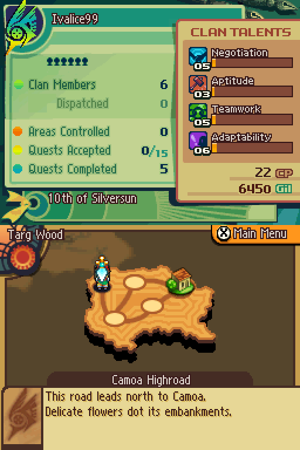

3. `x:0.4:2.5 down:0.4:1 a:0.5:3` (X menu, Clan Info) and confirm the clan
   panel.

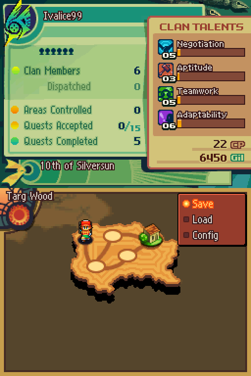

4. `b:0.4:2 up:0.4:1 a:0.5:3` (back, Roster). Unit 01 reads "RamzaBeou".

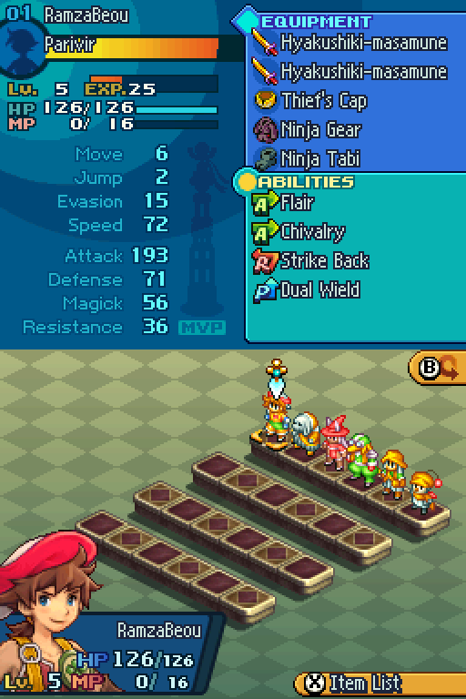

5. `a:0.5:3` opens the status screen, "01 RamzaBeou" (Parivir Lv.5 here).

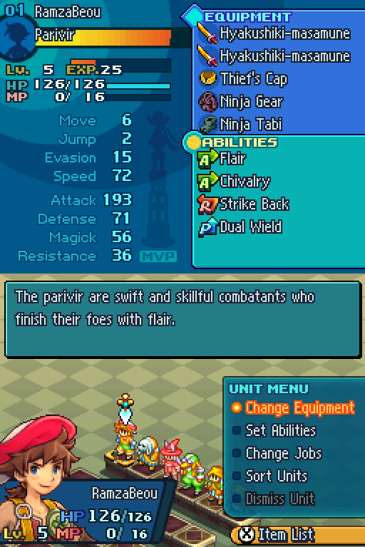

6. `b:0.4:2 b:0.4:2 b:0.4:2` back to the world map, then SAVE_S1.
7. RELOAD to `s1_reload` (port 3372) on `e1_saved.sav`. Title shows
   "RamzaBeou" persisted, play time advanced.

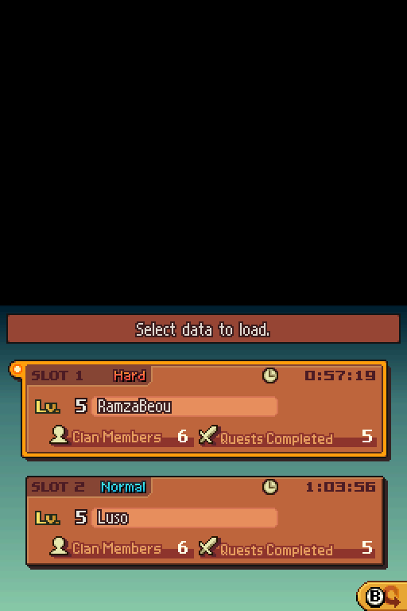

8. LOAD1, `x:0.4:2.5 a:0.5:3`. Roster still shows the new name after the
   game's own save and reload.


End condition: all 7 screenshots exist, reloaded screens show the new names,
playtime advanced at least 1 minute between step 1 and step 7.

Fragile: LOAD1 assumes the load screen cursor starts on slot 2, so the first
`up` lands on slot 1. On a different fixture, check e1_01 first and drop the
`up` if the cursor already sits on slot 1.

---

## E2: rename a generic unit with a race pool ROM name

Purpose. Prove unit level name_id edits resolve through JD_message_0.pak
names and the in game status screen.

Prep:

```bash
cp $FFTA2_SAVE "$OUT_DIR/e2e/e2_test.sav"
python3 -m ffta2_tool.cli rename "$OUT_DIR/e2e/e2_test.sav" --unit 2 --name "Alde"
scenarios/run_e2_alde.sh   # port 3376, sdir s2_alde
```

Steps:

1. BOOT, LOAD1, `x:0.4:2.5 a:0.5:3`.

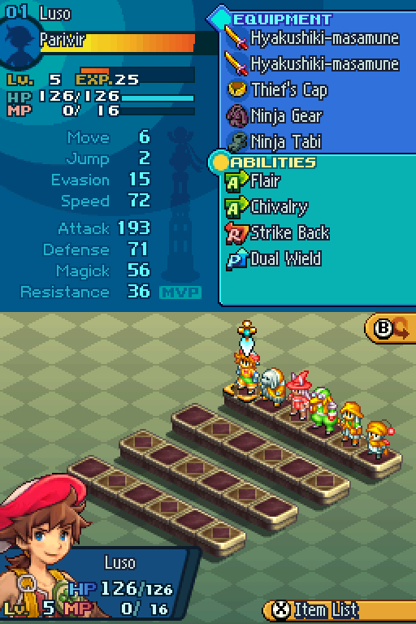

2. `right:0.15:1.5 a:0.5:3` (short tap to unit 2's pedestal). Status shows
   "02 Alde", Nu Mou Sage Lv.5, renamed from "Ganoslal".

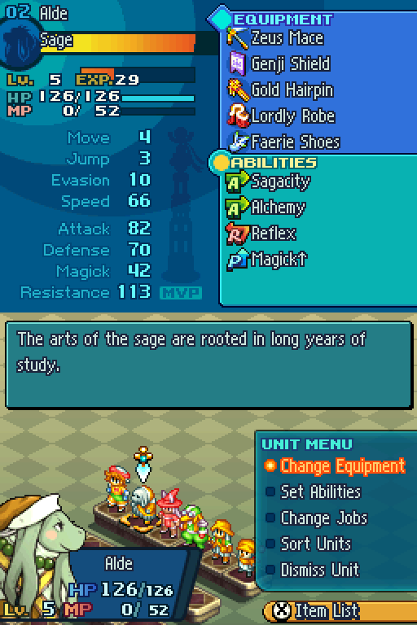

3. Stop. Read only scenario: no save, no reload.

End condition: the status screen shows the new name and the job line still
reads Nu Mou Sage, so the +0x18 / +0x1A job ids were untouched by rename.

---

## E3: inject a recruit (Viera Red Mage Lv.50), menus, save/reload

Purpose. The synthetic struct path: a brand new unit must render and act
sane in status, equipment, abilities, and job list, and the load screen must
count 7 members.

Prep:

```bash
cp $FFTA2_SAVE "$OUT_DIR/e2e/e3_test.sav"
python3 -m ffta2_tool.cli inject "$OUT_DIR/e2e/e3_test.sav" --slot 1 \
    --job "Red Mage" --level 50 --master-abilities --no-backup -u 7
scenarios/run_e3.sh        # port 3378, sdir s3
```

Steps:

1. BOOT. Load screen says Clan Members: 7.

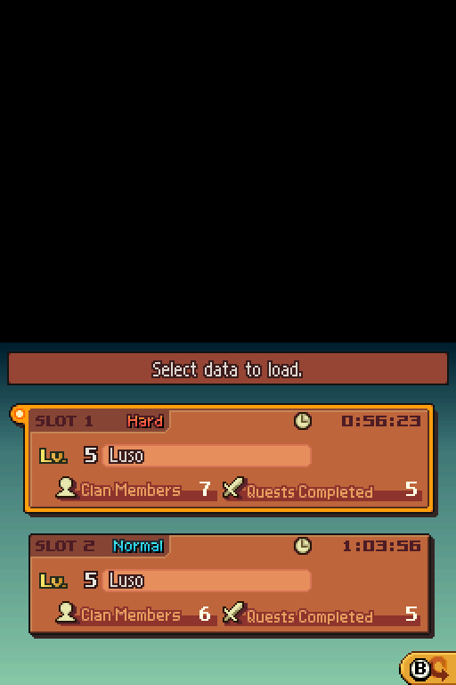

2. LOAD1, `x:0.4:2.5 a:0.5:3`, then `down:0.15:1.5` to row 2. Unit 7 "Acia"
   sits on row 2 pedestal 1.

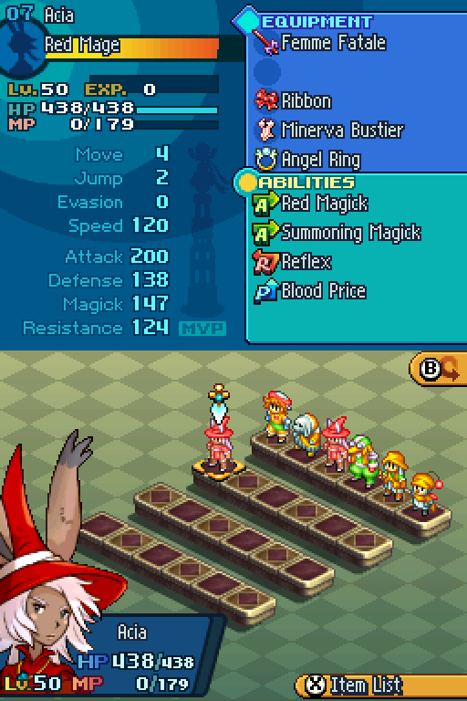

3. `a:0.5:3` opens status: "07 Acia", Red Mage Lv.50, HP 438/438,
   MP 0/179 (MP 0 outside battle is correct game semantics).

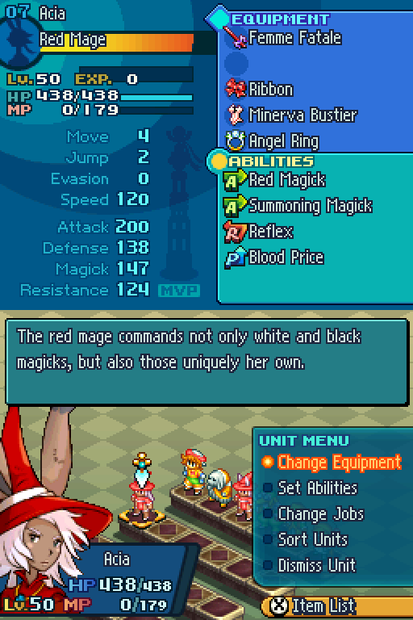

4. `a:0.5:3` opens equipment, sanity check the slots, then `b:0.4:2`.

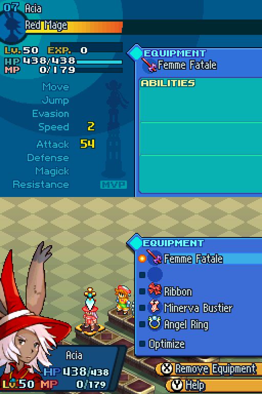

5. `down:0.15:1 a:0.5:3` opens abilities. Summoning Magick shows MASTER
   (our 0xFF AP bytes), then `b:0.4:2`.

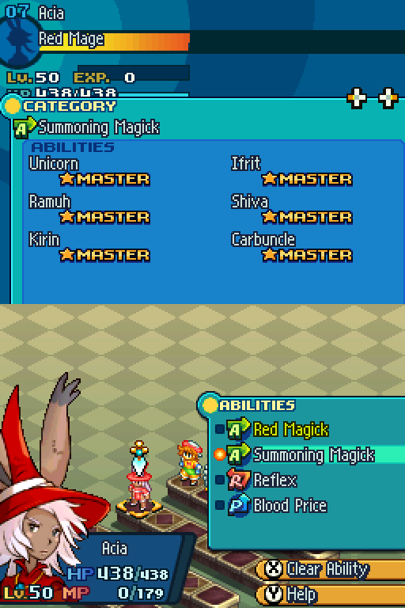

6. `down:0.15:1 a:0.5:3` opens jobs. Viera list marked MASTER, then
   `b:0.4:2` three times out.

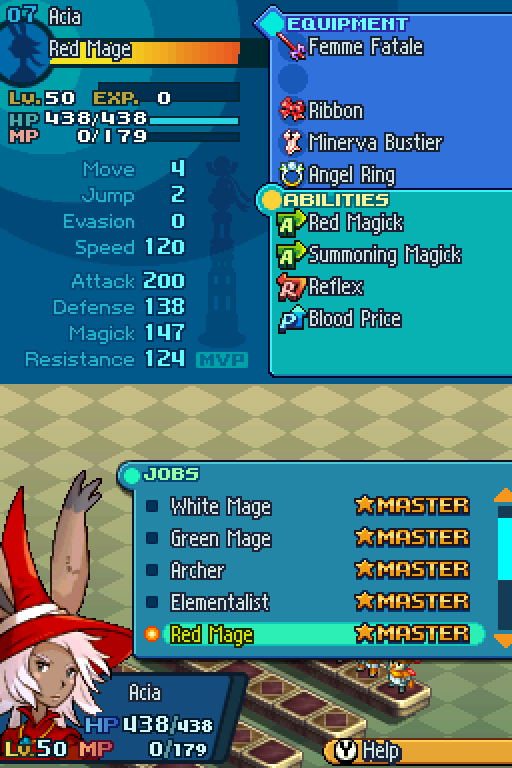

7. SAVE_S1, RELOAD (s3_reload, port 3380). Members count 7 persisted.


8. LOAD1, roster, `down:0.15:1.5`. Acia is still on row 2.


End condition: all 8 screenshots, member count 7 after reload, and
`scripts/manage_slots.py --save e3_saved.sav list` reports slot 1 checksum
VALID.

---

## E4: inject the roster to 24/24 and page the whole roster screen

Purpose. The stress case: 13 or more occupied unit slots is exactly what the
old keystream extraction corrupted. 24/24 is the extreme.

Prep (the documented 4 job loop reaches only 10 members from 6; you need 18
injections to reach 24, and only unoccupied slots, empty slots are refused):

```bash
cp $FFTA2_SAVE "$OUT_DIR/e2e/e4_test.sav"
while :; do
  n=$(python3 -c "from ffta2_tool.save import FFTA2Save;s=FFTA2Save('$OUT_DIR/e2e/e4_test.sav');print(sum(u.is_recruited for u in s.units))")
  [ "$n" = 24 ] && break
  python3 -m ffta2_tool.cli inject "$OUT_DIR/e2e/e4_test.sav" --slot 1 \
      --job "Cannoneer" --level 30 --no-backup 2>/dev/null || true
done
scenarios/run_e4.sh        # port 3382, sdir s4
```

Steps:

1. BOOT. Load screen: Clan Members 24.

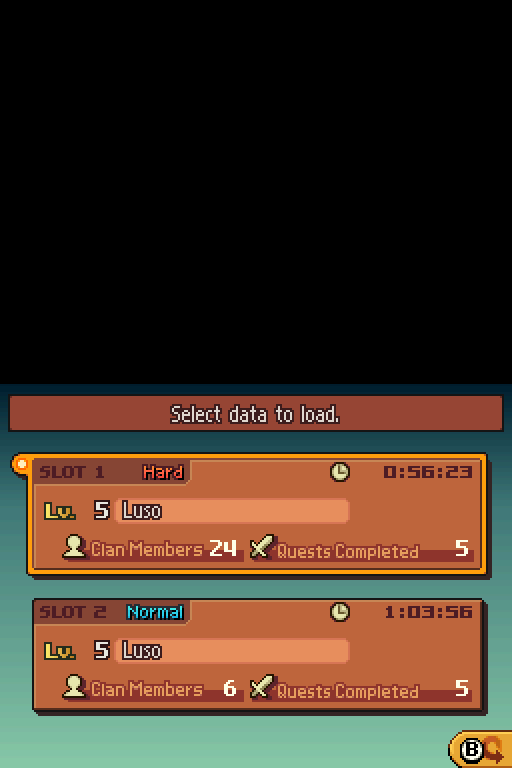

2. LOAD1, `x:0.4:2.5 a:0.5:3`. Roster row 1, units 1 to 6.

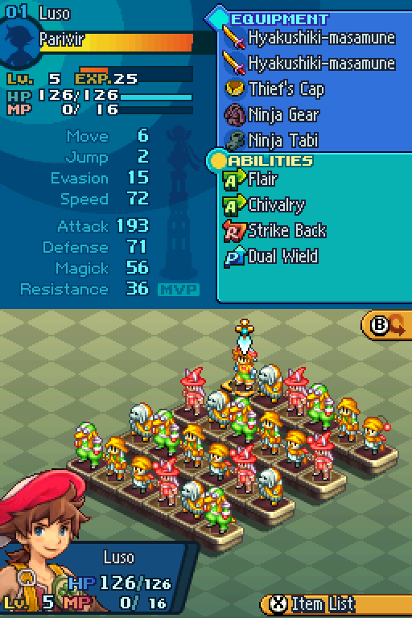

3. Three more `down:0.15:1.5`, one shot each row.

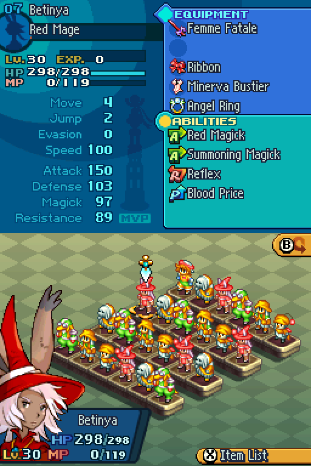

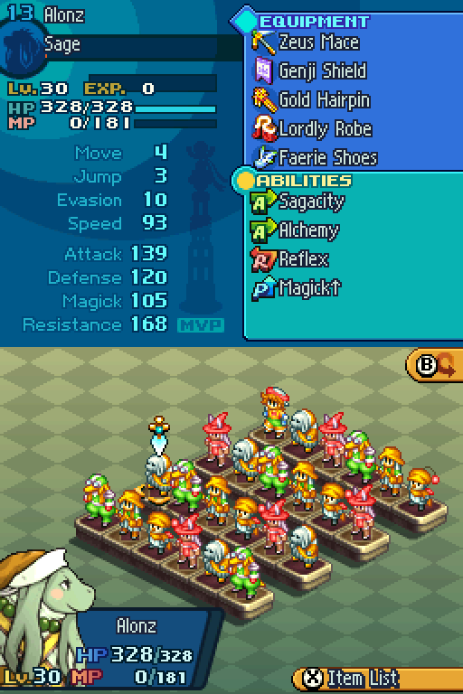

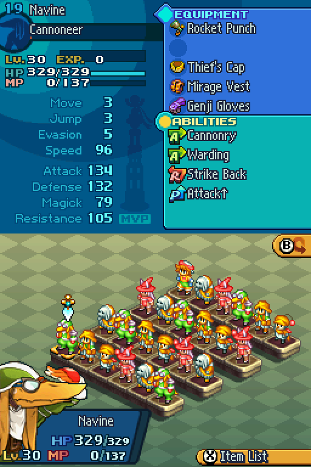

4. `right:0.15:1` five times then `a:0.5:3`. Unit 24 status opens:
   "24 Rodahl", Bangaa Cannoneer Lv.30.

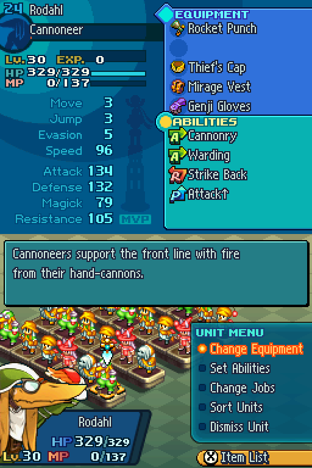

5. Stop. Read only.

End condition: 4 full roster rows with no gaps, unit 24 status opens, and
`python3 -m ffta2_tool.cli validate` passes on the fixture (decryption of a
24 slot roster is the point of this scenario).

---

## E5: live battle (deployment, turn 1 with the injected unit, quicksave)

Purpose. The hard proof. A tool injected unit must survive real time battle:
turn order (speed and level fields), action menus, AP writes, the Law card,
and in battle save and resume.

Prep and run (consolidated driver `run_e5_full.sh`, port 3600, session dir
`e5_final_session`):

```bash
cp $FFTA2_SAVE "$OUT_DIR/e2e/e5_final.sav"
python3 -m ffta2_tool.cli inject "$OUT_DIR/e2e/e5_final.sav" --slot 1 \
    --job "Viera White Mage" --name "Acia" --level 10 --no-backup
python3 -m ffta2_tool.cli validate "$OUT_DIR/e2e/e5_final.sav" --slot 1
bash examples/melonds/e2e/scenarios/run_e5_full.sh
bash examples/melonds/e2e/scenarios/verify_reload_exact.sh   # port 3610
```

Steps:

1. Accept a combat quest at a pub (the driver navigates: on merged.sav the
   Camoa route with "You Say Tomato" was used; the Targ Wood "Yellow Wings"
   route from the saved quest acceptance also works).
2. Walk the world and region map to the quest `!` node (scripted hops),
   enter, mash through the cutscene (30 A and B taps) and the Law card.
3. Deployment: rotate the 7 unit carousel with 4x `l:0.3:1.5`, confirm Acia,
   place her, confirm party and clan privilege.

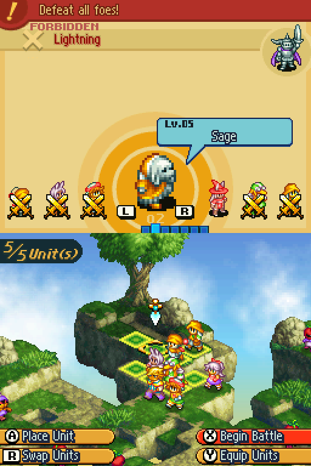

4. Battle intro (15 x a). Turn 1: Acia is highlighted in the turn queue,
   movement tiles lit, HP 156/156, MP 10/95 (battles grant MP, saves store
   cur_mp 0 outside battle), and the Law card shows privilege Power up 1
   from our unlocked mask.

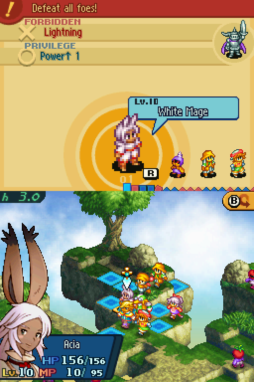

5. In battle Quick Save (`x:0.5:2`, menu up up A, then up A). "Save
   complete."

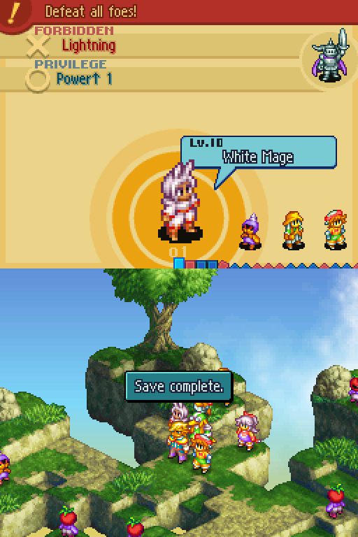

6. Back out to the title screen. Continue is now available.


7. `verify_reload_exact.sh`: pick Continue on the title prompt.

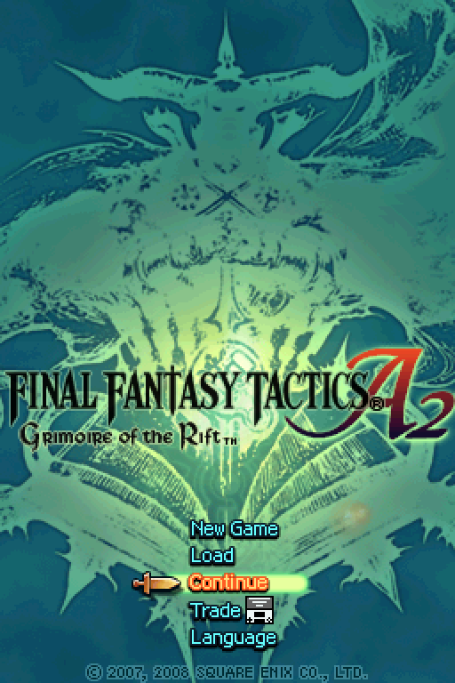

8. The game reloads into the same battle, units in formation.

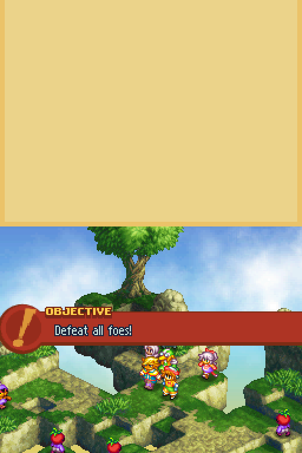

9. Acia's command menu opens again, law reminder intact.

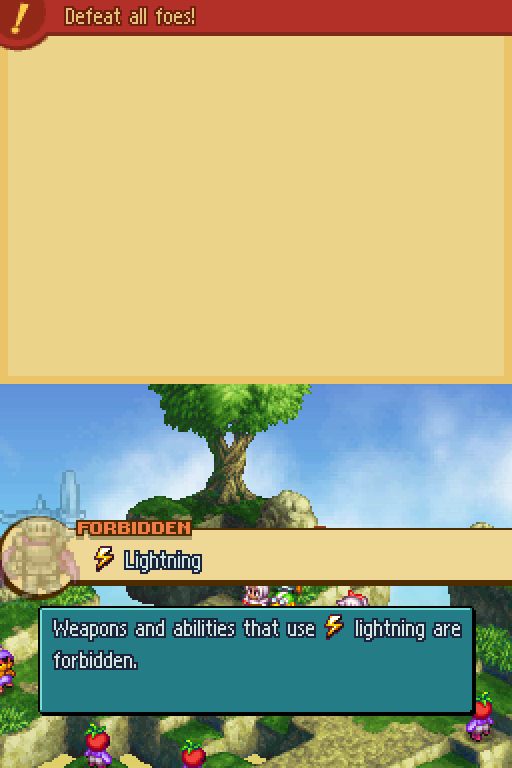

10. Stop, then post checks:
    `scripts/manage_slots.py --save $OUT_DIR/e2e/e5_final_saved.sav list`
    (slot 1 VALID), `cli info --slot 1`, `cli validate --slot 1` (0 errors).

End condition at the time of writing: steps 1 to 9 are proven. The remaining
leg is the aftermath: finish or Retreat the battle, save on the world map,
reload from title, and confirm the roster still counts 7 with Acia intact.
That post battle bookkeeping check belongs to E6, in progress. Known
limitation: in battle quicksave records do not decrypt with the tool's record
algebra, the game encrypts quicksave records differently from main slot
records (see the known limitations section and HARDEN_REPORT).

---

## Evidence index

Every embedded image above lives in `screenshots/` and is named exactly as
the drivers emit it. Two extra files from variant runs are kept out of this
doc: `e2_02_unit2_status.png` (run_e2.sh variant of the same subject) and
`e5_02_mid_battle_acia.png` (earlier E5 session). Screenshots from fresh runs
land in `$OUT_DIR/e2e/`; copy the ones you want to keep into `screenshots/`
and link them here.

## Known limitations and fragility

- Fixed sleeps everywhere (27 s boot, 9 s reload, 6 s continue). Timeline
  assumptions: load cursor starts on slot 2, SAVE_S1 overwrite prompt sits at
  `up` then A. Verify each against the first screenshot of that step on any
  new fixture.
- Blind mash loops (cutscene 30x, battle intro 15x, placement 8x) count on
  the cursor moving every tap. One dropped keystroke desyncs the rest.
- `mds.sh stop` is the only safe point to read a save file (flush and exit).
- Parallel sessions: 8 s start stagger, non overlapping ports.
- Scripts that strip `/tmp/.X{99..250}-lock` must not run while another
  session is alive (mds.sh allocates :130 to :160).
- In battle quicksave records: different crypto from main records, tool only
  reads and writes SLOT records, retiring quicksave entries still works.
- The only automated gates are the CLI commands (`validate`, `manage_slots
  list`); screenshot review is human. Never add `|| true` to those commands.
