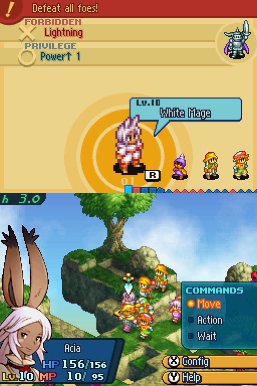
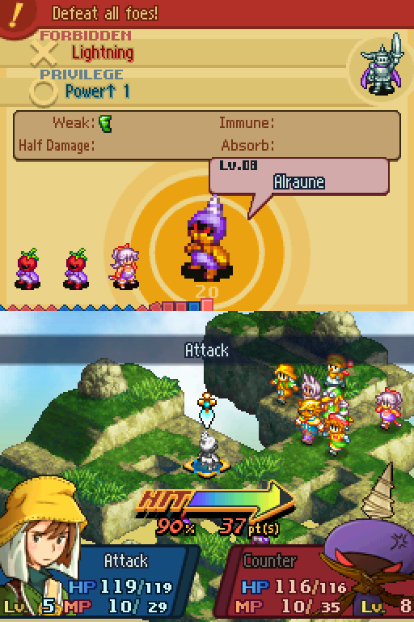
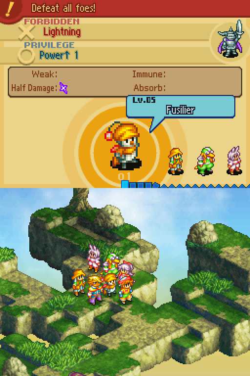
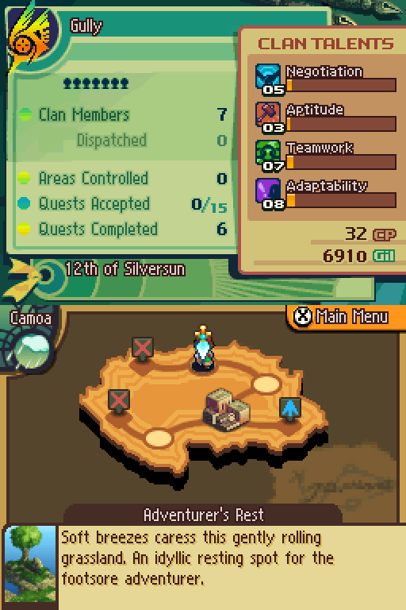
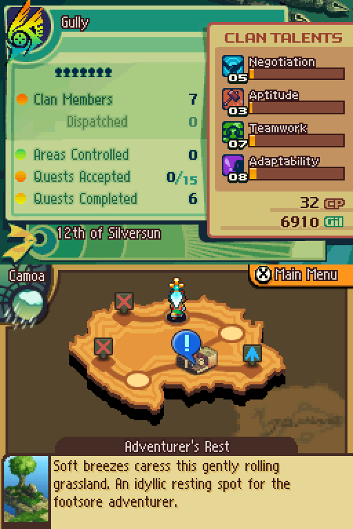
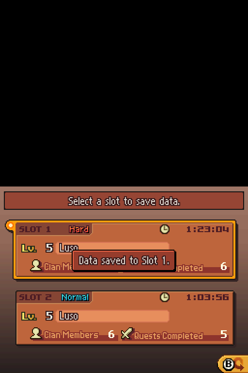
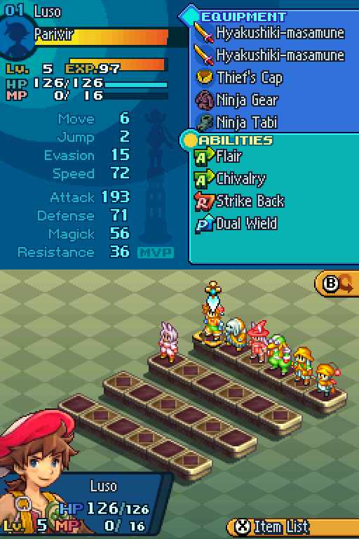
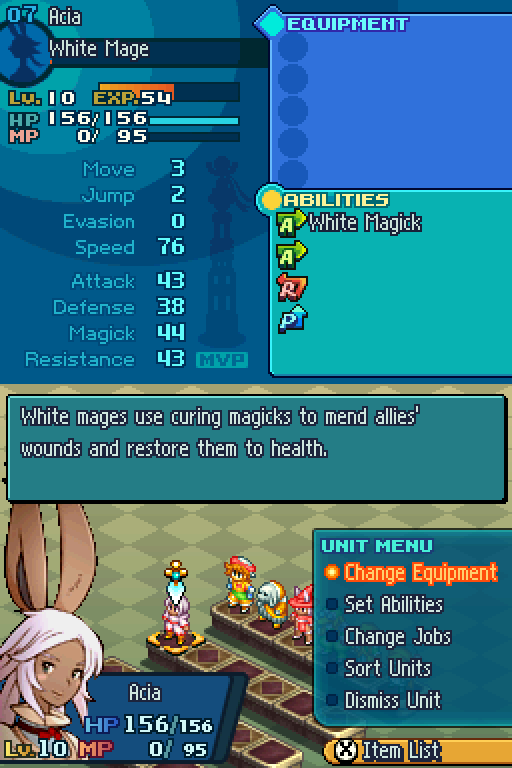

# FFTA2 melonDS E2E walkthrough

How to replay every end to end proof (rename, inject, full roster, live battle and its aftermath)
against melonDS: the exact keys pressed at each step, the screenshot that
captures it, and what has to be true at the end. The embedded screenshots were
produced with the scripts in `scenarios/` on one host; you can regenerate them
the same way.

Prerequisites:

1. Environment: `ROM_PATH` (default `/tmp/opencode/ffta2.nds`), `OUT_DIR`
   (default `/tmp`), `FFTA2_SAVE` (the fixture you run from), `MDS` (driver
   override). Scenario data lands under `$OUT_DIR/e2e/`.
2. Fixture saves: `fixtures/merged.sav` (SLOT 1 Hard, story flag 0x00AA,
   6 members, 6450 Gil) is the Traveler's Way state every scenario starts
   from. Copy it into each scenario's `_test.sav` name before running.
   Save files are never committed; screenshots are, in `screenshots/`.
3. melonDS rules: parallel session starts staggered 8 s apart, ONE gdb session
   per emulator start, aligned word writes only on ARM9, and ports spaced at
   least 2 apart (ARM9 = PORT, ARM7 = PORT+1).
4. Key notation `btn:hold:after`, all in seconds (`a:0.5:4` means press A for
   0.5 s, wait 4 s). Button to keyboard mapping: a=x, b=z, x=s, y=a, l=q,
   r=w, start=Return, select=BackSpace, dpad = arrow keys. D-pad steps in battle
   and in the roster need SHORT taps (`down:0.12:0.8`): a 0.4 s hold hits the game's
   key repeat and moves two rows.

Common macros used in every scenario:

| macro | what it does |
|---|---|
| BOOT | `mds.sh start <sdir> <sav> <port>`, `sleep 27`, then `a:0.5:4` (pass title) |
| LOAD1 | `a:0.6:1.5 up:0.4:1 a:0.6:4 a:0.6:6`, the load cursor starts on slot 2 |
| SAVE_S1 | `x:0.6:3 down:0.5:1 down:0.5:1 a:0.6:3 a:0.6:3 a:0.6:3 up:0.4:1 a:0.6:6 a:0.6:4`, in game save over slot 1 |
| RELOAD | `mds.sh stop <sdir> <out.sav>`, `sleep 9`, then BOOT again on the saved file, new port and session dir |
| shot | `mds.sh shot <sdir> <name>`, crops and 2x scales into `<sdir>/<name>.png` |

The two rules that bite hardest: (1) load waits are fixed sleeps tuned by
experiment, on a slower host they break silently; (2) `mds.sh stop` is what
flushes melonDS's save to disk, never read `game.sav` before stopping.

---

## E1: rename (leader and clan), full menu pass, save/reload persistence

Purpose. Prove a renamed leader and clan name survive the game's own save,
across every screen that reads the name strings (payload 0x01EC and 0x01D8).

Prep:

```bash
cp $FFTA2_SAVE "$OUT_DIR/e2e/e1_test.sav"
python3 -m ffta2_tool.cli rename "$OUT_DIR/e2e/e1_test.sav" --name "RamzaBeou"
python3 -m ffta2_tool.cli rename "$OUT_DIR/e2e/e1_test.sav" --clan-name "Ivalice99"
scenarios/run_e1.sh        # port 3370, sdir $OUT_DIR/e2e/s1
```

Steps (from run_e1.sh):

1. BOOT on `e1_test.sav`. Load screen shows SLOT 1 leader "RamzaBeou", SLOT 2
   still "Luso".


2. LOAD1. World map with clan name "Ivalice99".


3. `x:0.4:2.5 down:0.4:1 a:0.5:3` (X menu, Clan Info) and confirm the clan
   panel.


4. `b:0.4:2 up:0.4:1 a:0.5:3` (back, Roster). Unit 01 reads "RamzaBeou".


5. `a:0.5:3` opens the status screen, "01 RamzaBeou" (Parivir Lv.5 here).


6. `b:0.4:2 b:0.4:2 b:0.4:2` back to the world map, then SAVE_S1.
7. RELOAD to `s1_reload` (port 3372) on `e1_saved.sav`. Title shows
   "RamzaBeou" persisted, play time advanced.


8. LOAD1, `x:0.4:2.5 a:0.5:3`. Roster still shows the new name after the
   game's own save and reload.


End condition: all 7 screenshots exist, reloaded screens show the new names,
playtime advanced at least 1 minute between step 1 and step 7.

Fragile: LOAD1 assumes the load screen cursor starts on slot 2, so the first
`up` lands on slot 1. On a different fixture, check e1_01 first and drop the
`up` if the cursor already sits on slot 1.

---

## E2: rename a generic unit with a race pool ROM name

Purpose. Prove unit level name_id edits resolve through JD_message_0.pak
names and the in game status screen.

Prep:

```bash
cp $FFTA2_SAVE "$OUT_DIR/e2e/e2_test.sav"
python3 -m ffta2_tool.cli rename "$OUT_DIR/e2e/e2_test.sav" --unit 2 --name "Alde"
scenarios/run_e2_alde.sh   # port 3376, sdir s2_alde
```

Steps:

1. BOOT, LOAD1, `x:0.4:2.5 a:0.5:3`.


2. `right:0.15:1.5 a:0.5:3` (short tap to unit 2's pedestal). Status shows
   "02 Alde", Nu Mou Sage Lv.5, renamed from "Ganoslal".


3. Stop. Read only scenario: no save, no reload.

End condition: the status screen shows the new name and the job line still
reads Nu Mou Sage, so the +0x18 / +0x1A job ids were untouched by rename.

---

## E3: inject a recruit (Viera Red Mage Lv.50), menus, save/reload

Purpose. The synthetic struct path: a brand new unit must render and act
sane in status, equipment, abilities, and job list, and the load screen must
count 7 members.

Prep:

```bash
cp $FFTA2_SAVE "$OUT_DIR/e2e/e3_test.sav"
python3 -m ffta2_tool.cli inject "$OUT_DIR/e2e/e3_test.sav" --slot 1 \
    --job "Red Mage" --level 50 --master-abilities --no-backup -u 7
scenarios/run_e3.sh        # port 3378, sdir s3
```

Steps:

1. BOOT. Load screen says Clan Members: 7.


2. LOAD1, `x:0.4:2.5 a:0.5:3`, then `down:0.15:1.5` to row 2. Unit 7 "Acia"
   sits on row 2 pedestal 1.


3. `a:0.5:3` opens status: "07 Acia", Red Mage Lv.50, HP 438/438,
   MP 0/179 (MP 0 outside battle is correct game semantics).


4. `a:0.5:3` opens equipment, sanity check the slots, then `b:0.4:2`.


5. `down:0.15:1 a:0.5:3` opens abilities. Summoning Magick shows MASTER
   (our 0xFF AP bytes), then `b:0.4:2`.


6. `down:0.15:1 a:0.5:3` opens jobs. Viera list marked MASTER, then
   `b:0.4:2` three times out.


7. SAVE_S1, RELOAD (s3_reload, port 3380). Members count 7 persisted.


8. LOAD1, roster, `down:0.15:1.5`. Acia is still on row 2.


End condition: all 8 screenshots, member count 7 after reload, and
`scripts/manage_slots.py --save e3_saved.sav list` reports slot 1 checksum
VALID.

---

## E4: inject the roster to 24/24 and page the whole roster screen

Purpose. The stress case: 13 or more occupied unit slots is exactly what the
old keystream extraction corrupted. 24/24 is the extreme.

Prep (the documented 4 job loop reaches only 10 members from 6; you need 18
injections to reach 24, and only unoccupied slots, empty slots are refused):

```bash
cp $FFTA2_SAVE "$OUT_DIR/e2e/e4_test.sav"
while :; do
  n=$(python3 -c "from ffta2_tool.save import FFTA2Save;s=FFTA2Save('$OUT_DIR/e2e/e4_test.sav');print(sum(u.is_recruited for u in s.units))")
  [ "$n" = 24 ] && break
  python3 -m ffta2_tool.cli inject "$OUT_DIR/e2e/e4_test.sav" --slot 1 \
      --job "Cannoneer" --level 30 --no-backup 2>/dev/null || true
done
scenarios/run_e4.sh        # port 3382, sdir s4
```

Steps:

1. BOOT. Load screen: Clan Members 24.


2. LOAD1, `x:0.4:2.5 a:0.5:3`. Roster row 1, units 1 to 6.


3. Three more `down:0.15:1.5`, one shot each row.


4. `right:0.15:1` five times then `a:0.5:3`. Unit 24 status opens:
   "24 Rodahl", Bangaa Cannoneer Lv.30.


5. Stop. Read only.

End condition: 4 full roster rows with no gaps, unit 24 status opens, and
`python3 -m ffta2_tool.cli validate` passes on the fixture (decryption of a
24 slot roster is the point of this scenario).

---

## E5: live battle (deployment, turn 1 with the injected unit, quicksave)

Purpose. The hard proof. A tool injected unit must survive real time battle:
turn order (speed and level fields), action menus, AP writes, the Law card,
and in battle save and resume.

Prep and run (consolidated driver `run_e5_full.sh`, port 3600, session dir
`e5_final_session`):

```bash
cp $FFTA2_SAVE "$OUT_DIR/e2e/e5_final.sav"
python3 -m ffta2_tool.cli inject "$OUT_DIR/e2e/e5_final.sav" --slot 1 \
    --job "Viera White Mage" --name "Acia" --level 10 --no-backup
python3 -m ffta2_tool.cli validate "$OUT_DIR/e2e/e5_final.sav" --slot 1
bash examples/melonds/e2e/scenarios/run_e5_full.sh
bash examples/melonds/e2e/scenarios/verify_reload_exact.sh   # port 3610
```

Steps:

1. Accept a combat quest at a pub (the driver navigates: on merged.sav the
   Camoa route with "You Say Tomato" was used; the Targ Wood "Yellow Wings"
   route from the saved quest acceptance also works).
2. Walk the world and region map to the quest `!` node (scripted hops),
   enter, mash through the cutscene (30 A and B taps) and the Law card.
3. Deployment: rotate the 7 unit carousel with 4x `l:0.3:1.5`, confirm Acia,
   place her, confirm party and clan privilege.


4. Battle intro (15 x a). Turn 1: Acia is highlighted in the turn queue,
   movement tiles lit, HP 156/156, MP 10/95 (battles grant MP, saves store
   cur_mp 0 outside battle), and the Law card shows privilege Power up 1
   from our unlocked mask.


5. In battle Quick Save (`x:0.5:2`, menu up up A, then up A). "Save
   complete."


6. Back out to the title screen. Continue is now available.


7. `verify_reload_exact.sh`: pick Continue on the title prompt.


8. The game reloads into the same battle, units in formation.


9. Acia's command menu opens again, law reminder intact.


10. Stop, then post checks:
    `scripts/manage_slots.py --save $OUT_DIR/e2e/e5_final_saved.sav list`
    (slot 1 VALID), `cli info --slot 1`, `cli validate --slot 1` (0 errors).

End condition: steps 1 to 9 are proven by `scenarios/run_e5_full.sh`, which ends on the resumed
quicksave. Known limitation: in battle quicksave records do not decrypt with the tool's record
algebra, the game encrypts quicksave records differently from main slot records (see the known
limitations section and HARDEN_REPORT). The fight itself, the aftermath and the world map save
are E6.

---

## E6: win the battle, save on the world map, reload

Purpose. Prove the whole life of an injected unit: it fights, the fight is won with real attacks,
the game writes its own results into the save, and the save survives a cold reload. Nothing is
forged. `scenarios/run_e6_battle.py` runs it from the E5 quicksave:

```bash
OUT_DIR=/tmp/opencode/e2e_run bash examples/melonds/e2e/scenarios/run_e5_full.sh
OUT_DIR=/tmp/opencode/e2e_run python3 examples/melonds/e2e/scenarios/run_e6_battle.py
```

The bot (`battle.py`) reads the roster and the map cursor from RAM through the gdb stub
(`docs/save_format_map.md` section 10) and presses DS buttons through `mds.sh`. Per turn of one of
our units: Attack the nearest foe within 6 tiles (Action > Attack, walk the cursor onto the foe,
the forecast appears, A confirms); if that is out of reach, Move to the reachable tile closest to
the nearest foe and try again; otherwise Wait. The injected healer only fights foes within 2 tiles.
The log `e6_battle.log` lists every turn, the foe HP it saw and what it did.

1. RESUME. Title, Continue, answer the "Quick Save data will be deleted after it is loaded"
   prompt with Continue, then A through the OBJECTIVE, FORBIDDEN and PRIVILEGE banners until the
   COMMANDS menu shows. Acia (Lv.10 White Mage) acts first.



2. FIRST ATTACK. The attack forecast (HIT %, damage points, both name plates) is the proof that
   the bot reached a foe through the real UI. Foe HP then falls in RAM turn after turn.



3. VICTORY. The bot stops when every foe has 0 HP in RAM on two reads 2.5 s apart. The game then
   plays the post-battle dialogue.



4. QUEST REPORT. A through the dialogue until the report, then the world map returns with the
   rewards applied (quests completed up by one, clan points and gil up).





5. SAVE. `x`, down twice to System Menu, `a` Save, `a` slot 1, up, `a` "Overwrite and save.".
   After "Data saved to Slot 1." the driver waits 10 s and runs `mds.sh stop <sdir> out ref`, which
   exits 3 when game.sav still equals the quicksave (nothing flushed).



6. FILE GATES (`e6_report.txt`). Both checksums valid, validator without errors and without any
   issue the pre-battle slot lacked, gil or clan points higher, and a per-unit field diff. In the
   reference run the units that levelled up changed level, exp, speed, HP/MP caps and the four
   stats, the others changed exp only, and the injected White Mage went from exp 0 to 54.
7. RELOAD. Fresh boot on `e6_aftermath.sav`, title > Load. The slot card already shows the new
   quest count and play time.


8. After Load the world map matches the saved clan stats, and the driver reads the clan table out
   of RAM (`0x0212B118`, 0x11C bytes per unit) and requires it to equal the decrypted save byte
   for byte for every recruited unit.


9. Unit Info and the injected unit's status screen show the persisted level, exp and HP.





End condition: the script exits 0 and prints `E6 PASS`. Any failed gate exits 1 with the gate named;
a battle that does not end in VICTORY leaves `e6_fail_battle.png`.

Fragile: the pixel detectors (`dsbot.py`) are calibrated for the US ROM at the default melonDS
screen layout, and the quest and foe stats differ per run so turn counts vary. How far a unit can
walk is its Move stat from Unit Info (Luso 6, Cannoneer 3, Acia 3); the game rejects any tile
beyond it. The bot searches a fixed radius of 4 around the unit, so the farthest candidates are
sometimes refused, which costs a few seconds and nothing else. If the COMMANDS menu is never found, look at the
last screenshot first. The first reference run lost 2 minutes that way: a trait banner ("Fleet of
foot!") pushes the COMMANDS header up a row, so the detector now keys on the amber Config button
that only that menu shows (exactly 526 matching pixels in every COMMANDS frame of the 62 captured,
none elsewhere).

---

## Evidence index

Every embedded image above lives in `screenshots/` and is named exactly as
the drivers emit it. Two extra files from variant runs are kept out of this
doc: `e2_02_unit2_status.png` (run_e2.sh variant of the same subject) and
`e5_02_mid_battle_acia.png` (earlier E5 session). Screenshots from fresh runs
land in `$OUT_DIR/e2e/`; copy the ones you want to keep into `screenshots/`
and link them here.

## Known limitations and fragility

- Fixed sleeps everywhere (27 s boot, 9 s reload, 6 s continue). Timeline
  assumptions: load cursor starts on slot 2, SAVE_S1 overwrite prompt sits at
  `up` then A. Verify each against the first screenshot of that step on any
  new fixture.
- Blind mash loops (cutscene 30x, battle intro 15x, placement 8x) count on
  the cursor moving every tap. One dropped keystroke desyncs the rest. E6 avoids them with pixel
  detectors and RAM reads.
- `mds.sh stop` is the only safe point to read a save file (flush and exit).
- Parallel sessions: 8 s start stagger, non overlapping ports.
- Scripts that strip `/tmp/.X{99..250}-lock` must not run while another
  session is alive (mds.sh allocates :130 to :160).
- In battle quicksave records: different crypto from main records, tool only
  reads and writes SLOT records, retiring quicksave entries still works.
- The only automated gates are the CLI commands (`validate`, `manage_slots
  list`); screenshot review is human. Never add `|| true` to those commands.
